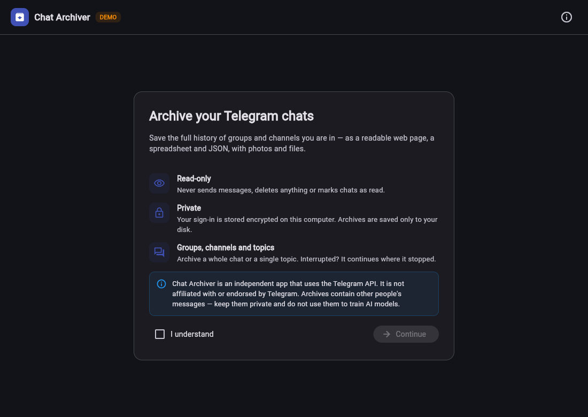
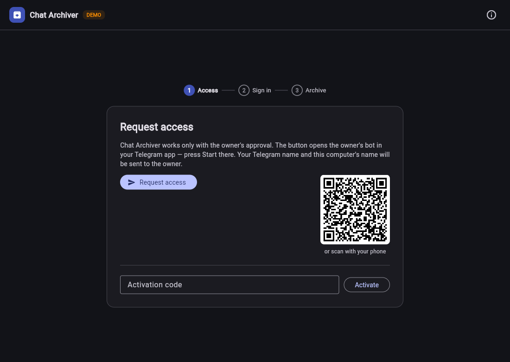
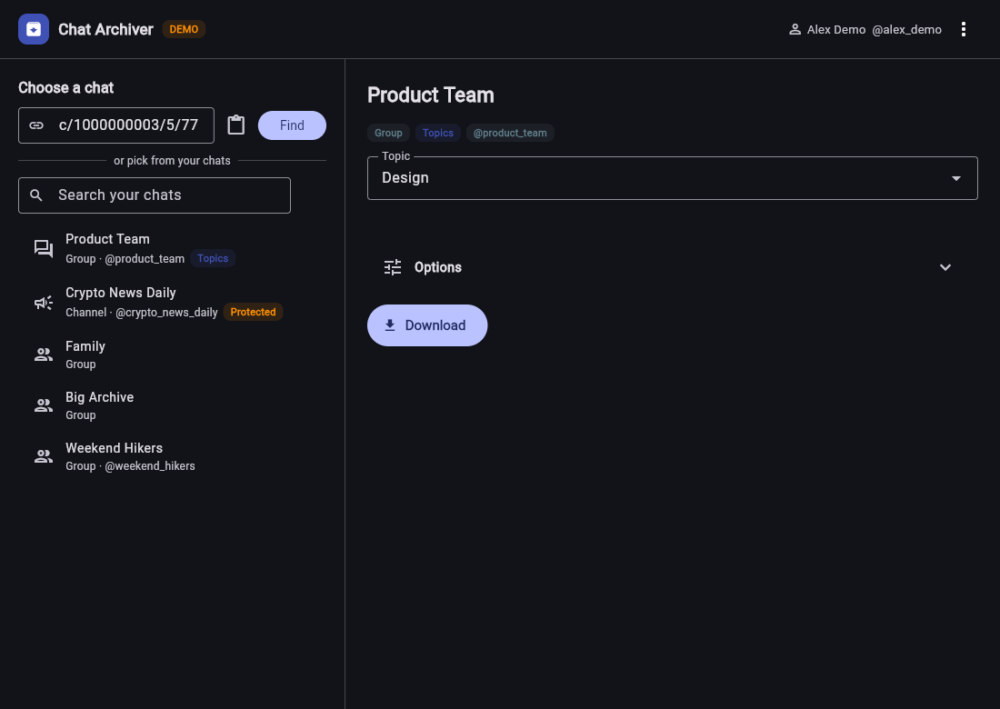
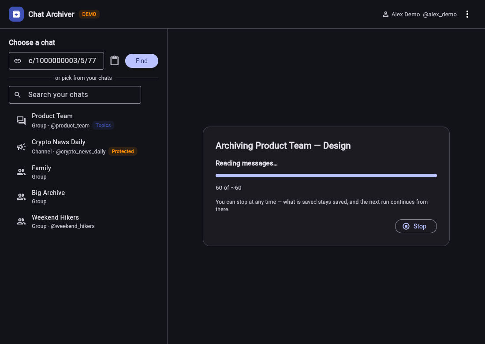
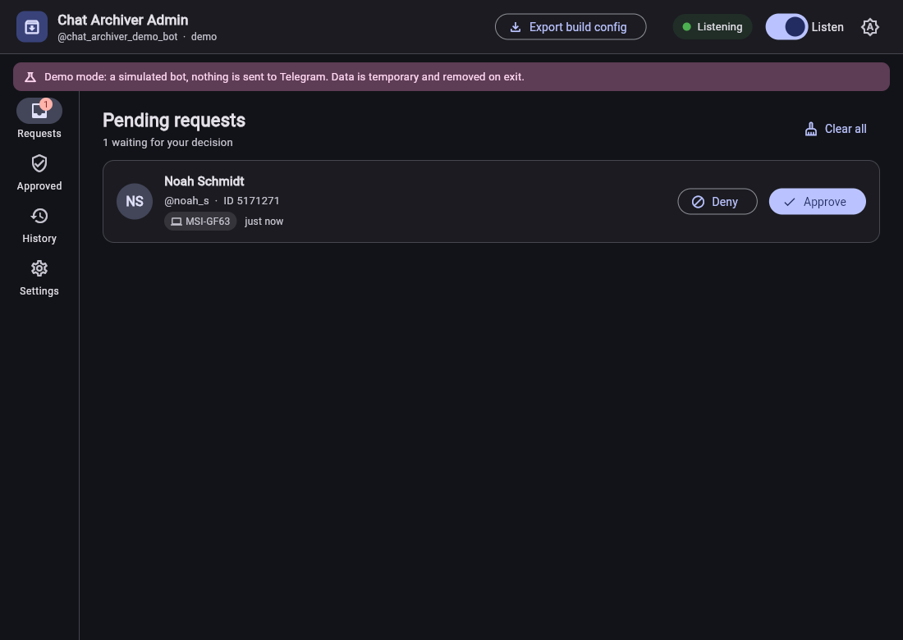
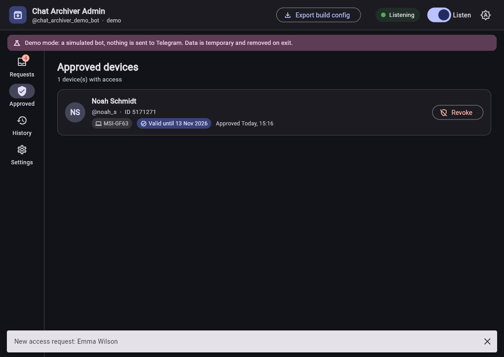

# Chat Archiver

A Windows desktop app that archives the full history of Telegram groups, channels and **forum topics**
you are a member of — as a readable web page, a spreadsheet and JSON, with photos and files.
It is shared only with people the owner approves personally, and the executable contains **no API keys**.

> Chat Archiver is an independent app that uses the Telegram API. It is not affiliated with Telegram.

| | |
|---|---|
|  |  |
|  |  |
|  |  |

## What it does

- **2–3 clicks for the user:** request access → sign in with a QR code → paste a chat link (or pick a chat) → Download.
- **Groups, channels and topics:** archive a whole forum group or one topic; a link to a message inside a topic selects that topic.
- **Resumable:** stop at any time; the next run continues from the last saved message and only fetches what's new.
- **Output:** `chat.html` (escaped, script-free with CSP), `messages.csv` (Excel-safe), `messages.json`, `media/`.
- **Owner approval:** every Telegram account is approved in **Chat Archiver Admin** (Approve / Deny / Revoke, history). Access lasts 14 days per device.
- **Several accounts:** one computer can hold several approved Telegram accounts — switch between them, add or remove accounts.

## How access works (no server, no keys in the exe)

```
 Chat Archiver (user)            Telegram                Chat Archiver Admin (owner)
 ───────────────────            ────────                ───────────────────────────
 device X25519 key pair
 "Request access"  ── t.me/<bot>?start=<device pubkey> ──►  getUpdates: who, which device
                                                           owner clicks Approve
 copy_text button  ◄── activation code (217 chars) ───────  {api_id, api_hash, user_id, expiry}
 verify Ed25519 signature                                   sealed to the device key
 decrypt with device key                                    (X25519 → HKDF → ChaCha20-Poly1305)
 sign in, check user_id + expiry (Telegram server time) + revoke notices
```

- The distributed exe holds only the bot's name and the owner's **public** verify key.
- A code works on one computer and for one Telegram account; it can't be forged or extended.
- The Telegram client is wrapped in a **read-only request allowlist**: it cannot send, edit, delete,
  react, mark as read or leave. Joining via an invite link happens only after a confirmation dialog.
- Secrets at rest (session, device key, Admin's token and keys) are encrypted with Windows DPAPI.

Details and residual risks: [docs/SECURITY.md](docs/SECURITY.md).

## Verification

- 89 offline tests (`python -m unittest discover -s tests -t .`): protocol, guard, topics, archive/resume, exports, Admin service, end-to-end approve → activate → revoke.
- Built executables are fully unpacked and searched for the real bot token, `api_id`, `api_hash` and owner key: 0 findings.
- An independent review pass found and fixed: a revocation bypass, a stuck QR screen and an export race.
- The project started as a reverse-engineering review of an existing Telethon scraper ([docs/REVERSE-REPORT.md](docs/REVERSE-REPORT.md), in Russian).

## Stack

Python 3.12 · [Telethon](https://github.com/LonamiWebs/Telethon) (MTProto) · [Flet](https://flet.dev) 1.0 (Flutter UI) ·
`cryptography` (X25519, Ed25519, ChaCha20-Poly1305) · Telegram Bot API (`httpx`) · SQLite · PyInstaller via `flet pack`.

```
approval/             activation-code protocol (shared)
tg_export/            core: read-only guard, encrypted vault, link parsing, SQLite archive, exporters, CLI
chat_archiver/        user app: backends (Telethon + demo), Flet UI
chat_archiver_admin/  owner app: Bot API listener, approvals, Flet UI
```

## Build

```powershell
uv venv --python 3.12 .venv
uv pip install --python .venv\Scripts\python.exe --require-hashes -r requirements.txt
uv pip install --python .venv\Scripts\python.exe --no-deps -e .
.venv\Scripts\python.exe -m chat_archiver --demo          # try the UI with a fake Telegram
.venv\Scripts\python.exe -m chat_archiver_admin --demo
build.cmd                                                 # after setting up Admin with your bot and API keys
```

Owner guide (RU): [docs/OWNER-GUIDE.md](docs/OWNER-GUIDE.md) · User guide: [docs/USER-GUIDE.md](docs/USER-GUIDE.md) ·
Console version `tg-export`: [docs/CLI.md](docs/CLI.md)

## License

MIT
